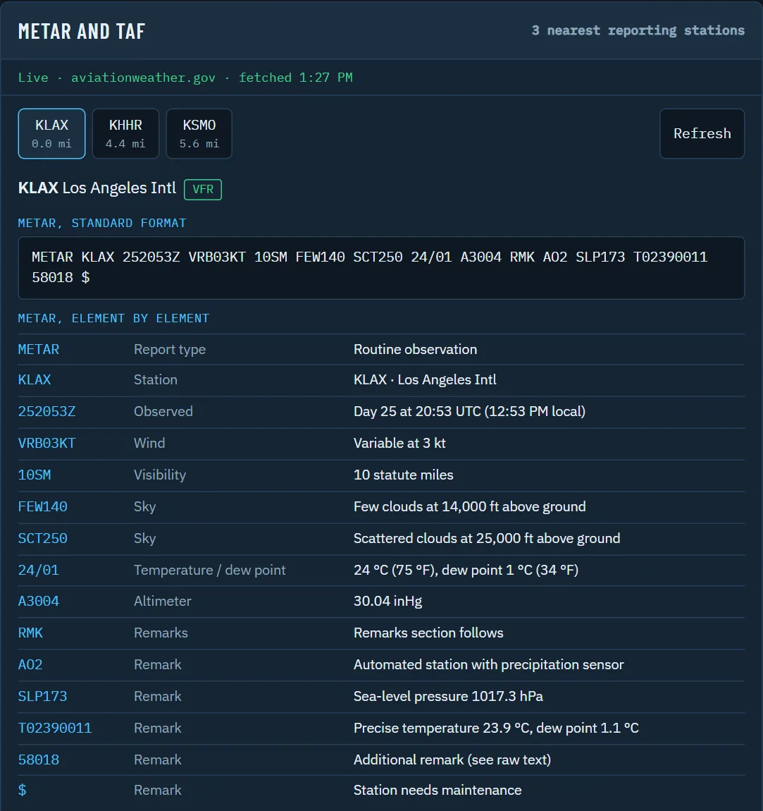

# SkyClear Pre-Flight

A drone pre-flight check for Southern California: airspace, LAANC, live aviation weather, altitude and a pilot checklist on one screen, ending in a GO / HOLD / NO-GO call and a self-certified pre-flight record.

**Live app: https://skyclear-preflight.vercel.app** (no sign-in; installs on a phone as an app)


> **Independent study and planning tool.** Not an FAA product and not an authorization. The remote pilot in command stays responsible for every check. Not affiliated with the FAA, Aloft or Airspace Link.

## What it does

Built while studying for the FAA Part 107 remote pilot exam, to answer one question at the launch point: *can I fly here, right now, and how high?*

1. **Find the launch point.** On open it asks for the phone's GPS (and shows the fix accuracy). If GPS is refused it starts at LAX. You can also type an **address or place name** (it's looked up and turned into latitude and longitude; when there are several matches you pick one), choose a preset, type coordinates, or tap the map.
2. **Check the airspace.** The FAA's own airspace layer says whether controlled airspace (Class B, C, D or E) reaches the ground there, and the FAA UAS Facility Map gives the LAANC grid ceiling. The result is shown as *Fly up to ___ ft AGL*, the same number in feet MSL, and whether LAANC authorization is needed.
3. **Read the weather.** Live METAR and TAF from aviationweather.gov for the 3 nearest reporting stations, decoded element by element (wind, visibility, clouds, temperature), with the observation time and age (amber over 75 minutes, red over 2 hours), and checked against the Part 107 weather minimums.
4. **Check TFRs.** Temporary flight restrictions from the FAA (tfr.faa.gov), checked for your planned flight time: inside an active TFR that reaches drone altitude is NO-GO; a TFR within 5 miles is a caution and is named in the status banner; any TFR within 10 miles is listed and drawn on the map. The row shows how old the data is and warns when it is more than 15 minutes old. The FAA says its TFR site may be incomplete, so SkyClear says so too and links the official sources. If the FAA feed can't be reached, the row says "Not checked". NOTAMs: a NOTAM check on the FAA NOTAM Management Service (NMS) is built and syncing every 3 minutes, but it runs on the FAA's pre-production (staging) data, so the live app does not use it yet; the NOTAMs row says "In testing" and links the FAA NOTAM Search. It will be switched on after the FAA approves production access.
5. **Run the checklist.** 18 pilot confirmations: certificate and recurrent training, registration and Remote ID, aircraft, TFRs, NOTAMs, people, line of sight.
6. **Get a call and a record.** GO, HOLD (for example, LAANC still needed) or NO-GO (a blocking condition, like a GPS fix more than 5 minutes old), plus a pre-flight record card with a SHA-256 fingerprint and a "Copy record text" button. The record is valid for 60 minutes.

| LAANC tab | Weather, decoded | On a phone |
|---|---|---|
|  |  |  |

## LAANC

- When LAANC is needed, the Pre-flight screen shows **File LAANC** buttons for the FAA-approved providers (from the FAA's list; where the grid is 0 ft, only providers that offer further coordination).
- The LAANC grid ceiling comes from the FAA's own UAS Facility Map service. A 0 ft grid shows in red as "not available via LAANC"; if the FAA data can't load, the ceiling shows "not confirmed", never an assumed 400 ft.

- **Saved FAA ceiling data** (`data/uasfm_ca_lv.json`, an export of the FAA UAS Facility Map for California, western Nevada and the edges of Arizona and Oregon) is the fallback when the live FAA lookup fails, shown in amber with its date, and a cross-check: if live and saved differ, the lower ceiling is used. A **Ceiling grid** map toggle colors every LAANC grid square by its ceiling.

## LAANC tab

- Shows whether the current spot needs LAANC and the altitude to ask for.
- Step-by-step request guides for two FAA-approved apps, **Aloft Air Control** and **Airspace Link AirHub Portal**, with support contacts checked on each company's own website. No contact detail is shown unless the company publishes it.
- A field for the LAANC authorization number. Once entered, the airspace check passes and the number goes on the record.

## Resources tab

Quick links to FAA TFRs, FAA NOTAM Search, METARs for the 3 nearest stations, and California State Parks drone rules, plus a directory of official sources (LAANC apps, FAA UAS Facility Maps, DroneZone, Remote ID, TRUST, Chart Supplement, NWS, Flight Service), phone numbers (911, the FAA UAS Support Center, 1-800-WX-BRIEF) and a short 14 CFR 107.49 preflight reference.

## Rules the app follows

- **The FAA is the source of truth.** Airspace, frequencies and altitudes come from FAA charts and FAA data layers. Nothing is invented: when a value isn't known, the app says *not confirmed*.
- **Weather is live or clearly labeled.** If the weather relay fails, the app shows labeled SAMPLE text and never presents it as live. The offline cache never stores weather.
- **GPS accuracy is checked, not just trusted.** The FAA airspace and LAANC grid layers are queried inside the GPS accuracy circle. If a different airspace or ceiling lies inside it, or the fix is rough (worse than ±50 m, like a computer's Wi-Fi location), the position is amber, the lower ceiling is used, and the app asks for a confirmed pin on the launch spot. Weak accuracy alone never blocks; only a missing fix or one older than 5 minutes is NO-GO.
- **An address is a starting point, not a GPS fix.** A looked-up position is marked as an address lookup with a caution, and the app asks for GPS at the launch point.
- **Pilot details stay on the device.** Name, certificate, drone and Remote ID are saved in the browser on that phone or computer only (with a Clear button). Nothing is sent to a server, and there are no accounts or analytics.

## How it's built

- **No framework, no build step on Vercel.** `index.html` is generated from `src/template.html`, `src/core.js` (airports, decoders, sun times) and `src/ui.js` (UI, map, loading) by `python3 src/build.py`.
- **`api/wx.js`:** a small Vercel serverless relay to aviationweather.gov (the API doesn't allow calls straight from a web page). Only `metar` and `taf` are allowed, inputs are checked, and responses are cached for 60 seconds.
- **`api/laanc.js`:** backup relay for the FAA LAANC grid and Class Airspace layers (the browser asks the FAA directly first).
- **`api/nms-sync.js`, `api/airspace-check.js` + `api/_nms/` (in testing):** NOTAM check on the FAA NOTAM Management Service. An Upstash QStash schedule calls `nms-sync` every 3 minutes (signed requests only); it pulls changes (a full pull at most once a day) into Upstash Redis, and pilots only ever read that store. TFR and drone-activity (UAS) notices are kept; their areas and altitude limits are read from the NOTAM text, because the service's map point is only a placeholder. Last good copy kept on errors; stale after 10 minutes. While on FAA staging data, `airspace-check` refuses to answer on the live site and the app shows it only on preview builds, labeled TEST DATA. Tests: `node tools/tests/nms.test.js`, `node tools/tests/nms-sync.test.js`.
- **`api/tfr.js` + `api/_tfr/`:** TFR import from tfr.faa.gov (active list, map shapes, detail XML for times and altitude limits). Responses are validated with zod, distances use Turf, the last good copy is kept when the FAA fails, and stale data is flagged. Tests: `node tools/tests/tfr.test.js`.
- **Map:** Leaflet 1.9.4 over Esri World Street Map, with FAA charts as overlays: the Las Vegas and Phoenix sectionals (`v/`, `p/`, cut the same way), the full Los Angeles sectional (`l/`, cut from the FAA's own georeferenced GeoTIFF with the legend, tables and Basin inset removed), plus the San Francisco sectional (`s/`) and the San Diego terminal area chart (`d/`), georeferenced from FAA PDFs. All are WebP tiles.
- **`api/geo.js`:** address lookup relay. It asks OpenStreetMap's Nominatim first (addresses and place names, United States only, © OpenStreetMap contributors), then the US Census Bureau geocoder if OpenStreetMap finds nothing. No keys; results are cached for a day, and matches within about 200 m of each other are merged.
- **Airport data:** every public-use airport in the chart coverage (366) from the FAA's NASR 28-day data (class, tower/ground/ATIS/CTAF frequencies, hours, elevation, weather station), generated into `src/airports_nasr.js` by `tools/nasr/make_airports.py`. The app flags when the 28-day cycle has ended.
- **Other public data:** USGS elevation service (ground elevation), National Weather Service (place name), FAA airspace and UAS Facility Map layers on ArcGIS.
- **Installable app (PWA):** `manifest.webmanifest`, app icons, and `sw.js`, a network-first service worker for the app shell only. It never touches `/api/` or other sites.

## Known gaps

- Airport data and charts cover the Los Angeles, San Francisco, Las Vegas and Phoenix sectionals and the San Diego TAC. The saved ceiling backup covers California, western Nevada and the edges of Arizona and Oregon, so most of Arizona relies on the live FAA lookup.
- NOTAMs are not used on the live site yet (the NOTAM check is in testing on FAA staging data) and special use airspace is not read; the app links the FAA NOTAM Search. Nationwide TFRs without a map shape are listed, not placed.

## Run it locally

```
python3 src/build.py          # rebuild index.html after editing src/
npx vercel dev                # serves the site and the /api/wx relay
```

FAA charts are U.S. government works. Map tiles © Esri.
