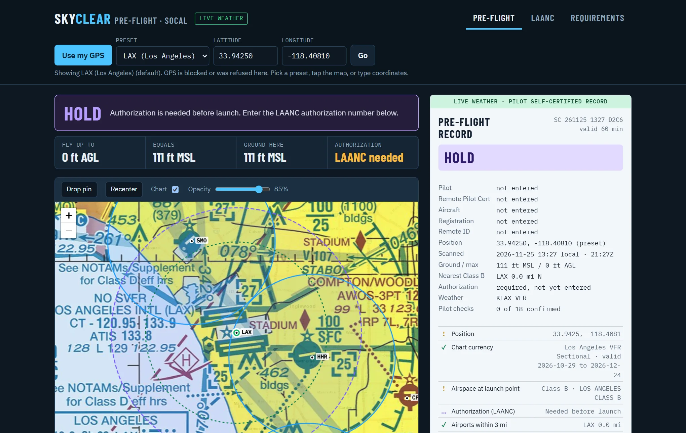
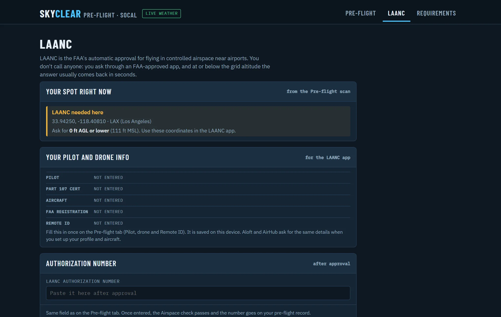
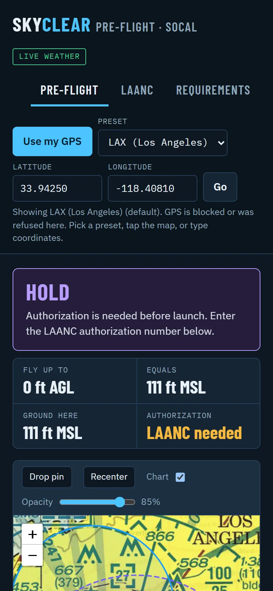

# SkyClear Pre-Flight

A drone pre-flight check for Southern California: airspace, LAANC, live aviation weather, altitude and a pilot checklist on one screen, ending in a GO / HOLD / NO-GO call and a self-certified pre-flight record.

**Live app: https://skyclear-preflight.vercel.app** (no sign-in; installs on a phone as an app)



> **Independent study and planning tool.** Not an FAA product and not an authorization. The remote pilot in command stays responsible for every check. Not affiliated with the FAA, Aloft or Airspace Link.

## What it does

Built while studying for the FAA Part 107 remote pilot exam, to answer one question at the launch point: *can I fly here, right now, and how high?*

1. **Find the launch point.** On open it asks for the phone's GPS (and shows the fix accuracy). If GPS is refused it starts at LAX. You can also type an **address or place name** (it's looked up and turned into latitude and longitude; when there are several matches you pick one), choose a preset, type coordinates, or tap the map.
2. **Check the airspace.** The FAA's own airspace layer says whether controlled airspace (Class B, C, D or E) reaches the ground there, and the FAA UAS Facility Map gives the LAANC grid ceiling. The result is shown as *Fly up to ___ ft AGL*, the same number in feet MSL, and whether LAANC authorization is needed.
3. **Read the weather.** Live METAR and TAF from aviationweather.gov for the 3 nearest reporting stations, decoded element by element (wind, visibility, clouds, temperature) and checked against the Part 107 weather minimums.
4. **Run the checklist.** 18 pilot confirmations: certificate and recurrent training, registration and Remote ID, aircraft, TFRs, NOTAMs, people, line of sight.
5. **Get a call and a record.** GO, HOLD (for example, LAANC still needed) or NO-GO (a blocking condition, like a GPS fix more than 5 minutes old), plus a pre-flight record card with a SHA-256 fingerprint and a "Copy record text" button. The record is valid for 60 minutes.

| LAANC tab | Weather, decoded | On a phone |
|---|---|---|
|  |  |  |

## LAANC tab

- Shows whether the current spot needs LAANC and the altitude to ask for.
- Step-by-step request guides for two FAA-approved apps, **Aloft Air Control** and **Airspace Link AirHub Portal**, with support contacts checked on each company's own website. No contact detail is shown unless the company publishes it.
- A field for the LAANC authorization number. Once entered, the airspace check passes and the number goes on the record.

## Resources tab

Quick links to FAA TFRs, FAA NOTAM Search, METARs for the 3 nearest stations, and California State Parks drone rules, plus a directory of official sources (LAANC apps, FAA UAS Facility Maps, DroneZone, Remote ID, TRUST, Chart Supplement, NWS, Flight Service), phone numbers (911, the FAA UAS Support Center, 1-800-WX-BRIEF) and a short 14 CFR 107.49 preflight reference.

## Rules the app follows

- **The FAA is the source of truth.** Airspace, frequencies and altitudes come from FAA charts and FAA data layers. Nothing is invented: when a value isn't known, the app says *not confirmed*.
- **Weather is live or clearly labeled.** If the weather relay fails, the app shows labeled SAMPLE text and never presents it as live. The offline cache never stores weather.
- **GPS accuracy is checked, not just trusted.** The FAA airspace and LAANC grid layers are queried inside the GPS accuracy circle. If a different airspace or ceiling lies inside it, or the fix is rough (worse than ±50 m, like a computer's Wi-Fi location), the position is amber, the lower ceiling is used, and the app asks for a confirmed pin on the launch spot. Weak accuracy alone never blocks; only a missing fix or one older than 5 minutes is NO-GO.
- **An address is a starting point, not a GPS fix.** A looked-up position is marked as an address lookup with a caution, and the app asks for GPS at the launch point.
- **Pilot details stay on the device.** Name, certificate, drone and Remote ID are saved in the browser on that phone or computer only (with a Clear button). Nothing is sent to a server, and there are no accounts or analytics.

## How it's built

- **No framework, no build step on Vercel.** `index.html` is generated from `src/template.html`, `src/core.js` (airports, decoders, sun times) and `src/ui.js` (UI, map, loading) by `python3 src/build.py`.
- **`api/wx.js`:** a small Vercel serverless relay to aviationweather.gov (the API doesn't allow calls straight from a web page). Only `metar` and `taf` are allowed, inputs are checked, and responses are cached for 60 seconds.
- **Map:** Leaflet 1.9.4 over Esri World Street Map, with FAA charts as overlays: the full Los Angeles sectional (`l/`, cut from the FAA's own georeferenced GeoTIFF with the legend, tables and Basin inset removed), plus the San Francisco sectional (`s/`) and the San Diego terminal area chart (`d/`), georeferenced from FAA PDFs. All are WebP tiles.
- **`api/geo.js`:** address lookup relay. It asks OpenStreetMap's Nominatim first (addresses and place names, United States only, © OpenStreetMap contributors), then the US Census Bureau geocoder if OpenStreetMap finds nothing. No keys; results are cached for a day, and matches within about 200 m of each other are merged.
- **Other public data:** USGS elevation service (ground elevation), National Weather Service (place name), FAA airspace and UAS Facility Map layers on ArcGIS.
- **Installable app (PWA):** `manifest.webmanifest`, app icons, and `sw.js`, a network-first service worker for the app shell only. It never touches `/api/` or other sites.

## Known gaps

- Airport, tower and frequency data covers Southern California only. Charts now cover the whole Los Angeles sectional (Big Sur to Blythe, Lemoore to the border) and the San Francisco sectional, with no gap between them.
- TFRs, NOTAMs and special use airspace are not read yet; the checklist sends the pilot to tfr.faa.gov and the FAA NOTAM search.

## Run it locally

```
python3 src/build.py          # rebuild index.html after editing src/
npx vercel dev                # serves the site and the /api/wx relay
```

FAA charts are U.S. government works. Map tiles © Esri.
